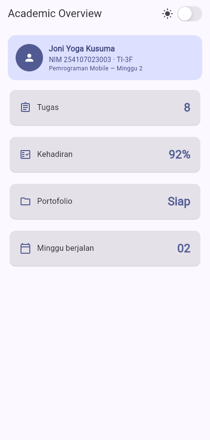
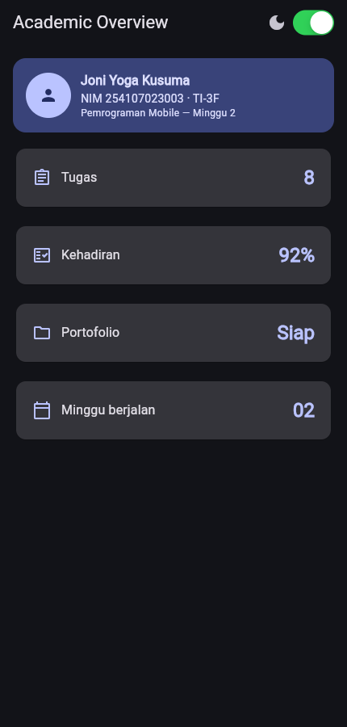
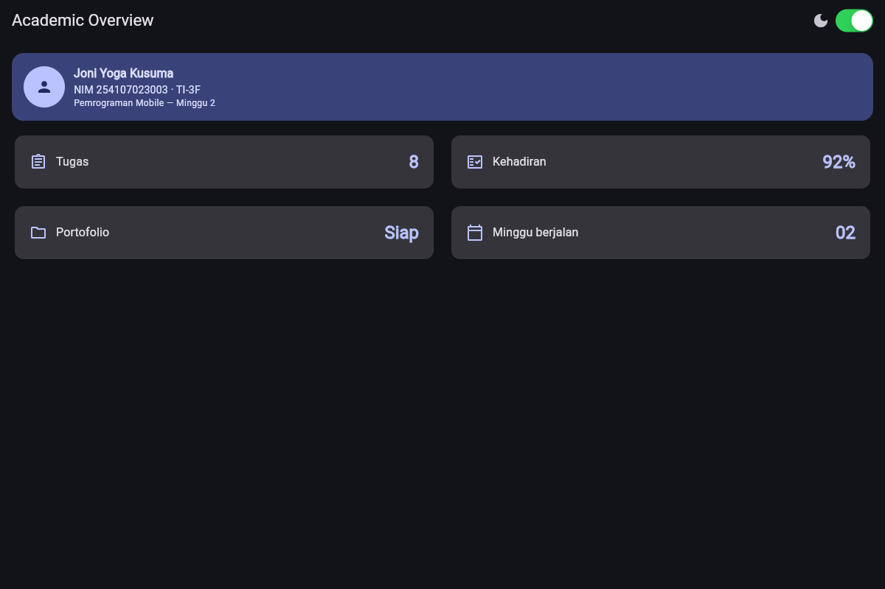

# Minggu 2 — Declarative UI & Responsive Design

Sumber: [Codelab Minggu 2](https://jti-polinema.github.io/flutter-codelab/02-minggu-2-declarative-ui-responsive-design/index.html)

Tanggal commit portofolio: **Kamis, 10 September 2026**. Tanggal ini merupakan metadata jadwal mingguan, bukan bukti waktu push ke GitHub.

| | |
| --- | --- |
| Nama | Joni Yoga Kusuma |
| NIM | 254107023003 |
| Kelas | TI-3F |

## Tujuan

Membangun halaman **Academic Overview** yang deklaratif dan responsif: satu kolom pada layar sempit, dua kolom pada layar lebar, dengan tema terang/gelap, widget Material 3 + Cupertino, serta label aksesibilitas.

## Fitur utama

- Header profil mahasiswa (`Container`, `Row`, `Column`, `Expanded`)
- Empat kartu informasi lewat widget reusable `InfoCard`
- `LayoutBuilder` + breakpoint `kWideBreakpoint` (700)
- Toggle tema dengan `CupertinoSwitch` pada `AppBar`
- `Semantics` pada profil, kartu, dan sakelar tema
- Warna dan tipografi mengikuti `Theme.of(context)`

## Stack teknologi

- Flutter 3.47.2 (stable)
- Dart 3.13.2
- Material 3 (`ColorScheme.fromSeed`)
- Cupertino (`CupertinoSwitch`)

## Cara menjalankan

```powershell
cd 02-week-2-declarative-ui-responsive-design
flutter pub get
flutter analyze
flutter test
flutter run
```

Uji ukuran sempit dan lebar (resize jendela Chrome/desktop, atau emulator ~5" lalu ~10"). Tekan sakelar di `AppBar` untuk membandingkan light dan dark theme.

## Hasil

- Header profil berisi nama, NIM, dan kelas; riwayat eksperimen warm-up tidak diverifikasi ulang.
- Dashboard Academic Overview berjalan pada layar sempit dan lebar
- Dark mode tetap terbaca karena warna diambil dari `ColorScheme`
- `flutter analyze` tanpa error
- Widget test responsif dan toggle tema lulus
- Screenshot di bawah diambil dari aplikasi yang dijalankan ulang pada 14 Oktober 2026. Log: [docs/validation.txt](docs/validation.txt).

### Layar sempit — tema terang



### Layar lebar — tema terang


### Layar sempit — tema gelap



### Layar lebar — tema gelap



## AI Prompt Challenge

Penyempurnaan dokumentasi dan verifikasi aplikasi pada repository ini dibantu AI. Urutan pengerjaan mandiri sebelum penggunaan AI tidak dapat diverifikasi dari source yang tersedia. Bagian berikut mencatat alternatif layout dan alasan teknis yang perlu dipahami saat review.

### 1. Prompt desain

> Bandingkan dua tata letak dashboard akademik untuk Flutter: versi `GridView` dan versi `LayoutBuilder` + `Column`. Jelaskan trade-off responsif dan aksesibilitasnya.

Ringkasan output yang dipakai:

| | `GridView.count` | `LayoutBuilder` + `Column`/`Row` |
| --- | --- | --- |
| Responsif | `crossAxisCount` mudah diubah dari lebar | Kontrol penuh: 1 kolom atau baris berisi dua `Expanded` |
| Tinggi kartu | `childAspectRatio` tetap; teks besar atau font scale bisa terpotong | Tinggi mengikuti konten |
| Scroll | Sudah built-in | Perlu `SingleChildScrollView` |
| Aksesibilitas | `Semantics` tetap bisa, tetapi rasio tetap merugikan text scaling | Lebih aman untuk text scale dan label per kartu |
| Kesesuaian tugas | Sedikit menyembunyikan `Row`/`Column`/`Expanded` | Langsung memakai widget yang diminta tugas utama |

### 2. Prompt penguatan konsep

> Jelaskan kapan penggunaan `Expanded` justru menyebabkan overflow di dalam `Row`, beri contoh kode yang gagal dan perbaikannya.

`Expanded` hanya aman jika ancestor pada sumbu utama memberi **batas lebar yang terhingga**. Jika `Row` itu sendiri tidak dibatasi (misalnya di dalam `Row` lain tanpa `Expanded`, atau di dalam widget yang melewati lebar intrinsik), child `Expanded` tidak punya sisa ruang yang terdefinisi — atau sibling berukuran intrinsik terlalu lebar — lalu muncul overflow.

Contoh yang gagal: `Row` di dalam `Row` tanpa `Expanded` pada child dalam, plus teks panjang tanpa flex.

```dart
Row(
  children: [
    Row(
      children: [
        Expanded(child: Text('Nama yang sangat panjang tanpa batas lebar')),
      ],
    ),
  ],
)
```

Perbaikan: beri batas lebar pada `Row` dalam, biasanya dengan `Expanded` di parent.

```dart
Row(
  children: [
    Expanded(
      child: Row(
        children: [
          Expanded(child: Text('Nama yang sangat panjang tetap membungkus')),
        ],
      ),
    ),
  ],
)
```

Pada kartu profil, `Expanded` di sebelah `CircleAvatar` mencegah overflow nama. Tanpa itu, teks panjang mendorong lebar `Row` melebihi parent.

### 3. Verification prompt

> Periksa kembali rekomendasi layout di atas: apakah tetap responsif di bawah 600px, apakah mengurangi aksesibilitas, dan apakah ada widget yang tidak tersedia di Flutter stabil saat ini?

Hasil audit yang dicek ulang di kode:

- Di bawah 600px tetap satu kolom karena `kWideBreakpoint = 700`.
- Aksesibilitas tidak diturunkan: setiap kartu punya label `title, value`; sakelar punya label state; ikon dekoratif di-`ExcludeSemantics`; kontras mengikuti `ColorScheme` (bukan warna hardcode).
- Widget yang dipakai (`LayoutBuilder`, `Column`, `Row`, `Expanded`, `Container`, `Card`, `CupertinoSwitch`, `Semantics`, `Theme.of`) tersedia di Flutter stable.

### 4. Keputusan yang dipilih

Dipilih **`LayoutBuilder` + `Column` + `Row`/`Expanded`**, bukan `GridView.count`.

Alasan teknis:

1. Tugas utama mensyaratkan `Row`, `Column`, `Expanded`, dan `Container` secara eksplisit.
2. `childAspectRatio: 2.6` pada contoh `GridView` berisiko memotong nilai kartu saat text scale > 100%.
3. Jumlah kartu hanya empat, jadi scroll `SingleChildScrollView` cukup dan prediktabel.
4. Breakpoint didefinisikan sekali (`kWideBreakpoint`) sehingga test dan UI memakai angka yang sama.

Bukti: `flutter test` (lebar kartu < 700 pada 400px; kartu kedua di kanan pada 1200px) dan screenshot di `screenshots/`.

## Refactoring

- Kartu diekstrak ke `InfoCard` (`title`, `value`, `icon`).
- Warna/tipografi dari `Theme.of(context).colorScheme` dan `textTheme`.
- Breakpoint hanya di `kWideBreakpoint`.
- `flutter analyze` dijalankan setelah rapikan.

## Refleksi

- **Imperative vs declarative.** Imperative mengubah widget yang sudah ada satu per satu (`setText`, `setColor`). Declarative mendeskripsikan UI dari state saat ini; `setState` pada `isDark` membuat Flutter membangun ulang `themeMode` dan ikon, bukan mengedit switch secara manual.
- **`Expanded`.** Membantu membagi sisa ruang di `Row`/`Column` yang sudah punya batas (nama di header, judul kartu, dua kolom lebar). Menjadi error jika parent tidak membatasi sumbu utama, atau jika semua sibling memaksa ukuran intrinsik melebihi parent.
- **Breakpoint dan theme.** Breakpoint 700 memisahkan pola ponsel (satu kolom, scan vertikal) dan tablet (dua kolom, lebih sedikit scroll). Theme terpusat menjaga kontras light/dark tanpa menyalin warna.
- **Verifikasi AI.** Saran `LayoutBuilder` + tinggi intrinsik dipakai karena lolos uji < 600px, tidak memotong text scale, dan tidak memakai widget di luar stable. `GridView` tetap valid untuk daftar panjang, tetapi tidak dipilih untuk tugas ini.

## Referensi

- [Flutter UI](https://docs.flutter.dev/ui)
- [Building adaptive and responsive apps](https://docs.flutter.dev/ui/adaptive-responsive)
- [Material Design 3](https://m3.material.io/)
- [Flutter accessibility](https://docs.flutter.dev/ui/accessibility-and-internationalization/accessibility)
