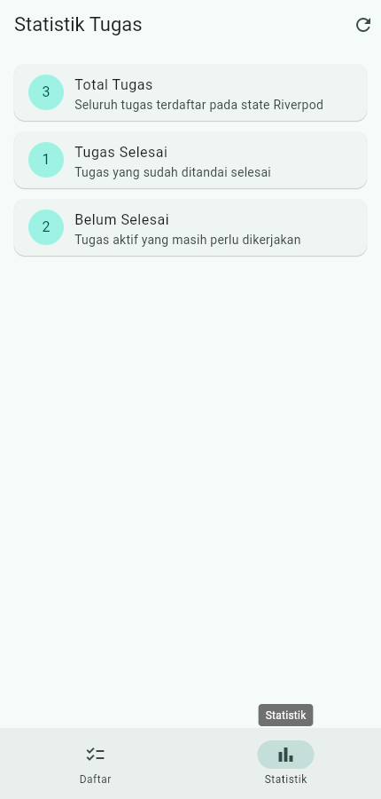

# Minggu 3 — Navigation & State Management

Joni Yoga Kusuma · NIM 254107023003 · TI-3F

[Codelab Minggu 3](https://jti-polinema.github.io/flutter-codelab/03-minggu-3-navigation-state-management/index.html)

Tanggal metadata commit untuk jadwal tugas: **Kamis, 17 September 2026**. Tanggal ini bukan waktu push GitHub. Verifikasi dan screenshot dilakukan **14 Oktober 2026**.

## Tujuan dan fitur

Menerapkan navigasi GoRouter serta state sinkron/asinkron dengan Riverpod. Route `/` berisi daftar ToDo, `/detail/:id` menampilkan detail berdasarkan ID, dan `/stats` menampilkan tiga statistik tugas.

- Tambah, tandai selesai, hapus, dan filter tugas menggunakan list immutable.
- Widget `TodoTile` dan provider filter terpisah; NavigationBar berpindah daftar/statistik.
- Statistik mengikuti daftar aktual dan menampilkan loading, error dengan retry, serta data. Simulasi runtime memakai delay 2 detik dan peluang gagal 30%; tes memakai konfigurasi deterministik.

## Menjalankan

Flutter 3.47.2 / Dart 3.13.2, `go_router`, `flutter_riverpod`.

```powershell
cd 03-week-3-navigation-state-management
flutter pub get
flutter analyze
flutter test
flutter run -d chrome
```

State ToDo tersimpan di memori selama aplikasi berjalan; reload mengosongkan daftar.

## Hasil dan screenshot

Pada 14 Oktober 2026, analisis statis bersih, **4 tes lulus**, dan build web berhasil. Lihat [output verifikasi](docs/validation.txt) serta [audit AI Challenge](docs/ai-challenge.md).

Screenshot berikut merekam aplikasi web yang dijalankan; isi tugas merupakan data contoh yang dimasukkan melalui UI.




## Refleksi

`setState` sesuai untuk state lokal; Riverpod membagikan daftar yang sama ke beberapa halaman. `context.go` berpindah tab utama, sedangkan `context.push` mempertahankan tumpukan saat membuka detail. `AsyncValue.when` membuat cabang loading/error/data eksplisit. Konfigurasi simulasi yang bisa diinjeksi membuat tes cepat dan dapat diulang.
