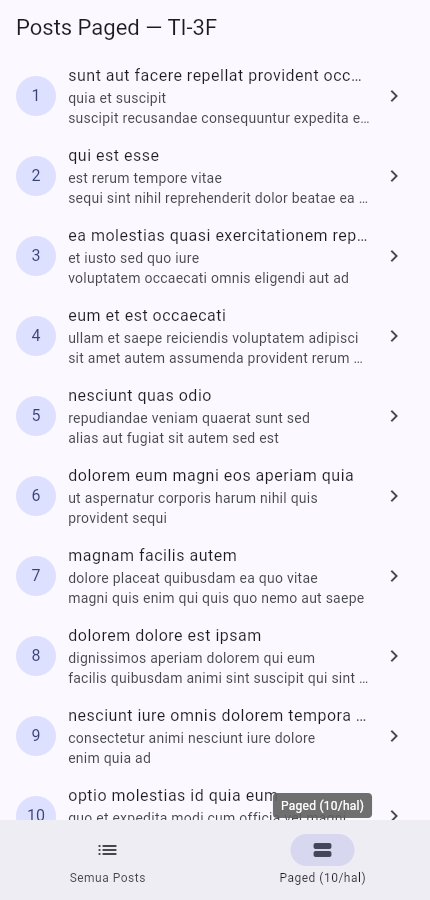

# Minggu 4 — Networking & REST API

Joni Yoga Kusuma · NIM 254107023003 · TI-3F

[Codelab Minggu 4](https://jti-polinema.github.io/flutter-codelab/04-minggu-4-networking-rest-api/index.html)

Tanggal metadata commit untuk jadwal tugas: **Kamis, 24 September 2026**. Tanggal ini bukan waktu push GitHub. Verifikasi dan screenshot dilakukan **14 Oktober 2026**.

## Tujuan dan fitur

Mengambil posts/komentar dari JSONPlaceholder menggunakan Dio, repository, model JSON, dan Riverpod.

- Dio terpusat dengan timeout dan logging; UI memanggil repository melalui provider.
- Daftar menangani loading, error dengan retry, kosong, dan sukses; pull-to-refresh tersedia.
- Pagination 10 item per halaman dengan guard request ganda, retry halaman gagal, dan indikator akhir data.
- Route `/post/:id` menampilkan isi lengkap serta komentar. Tab kedua membuka `/paged`.
- `PostTile` dan pemetaan pesan error dipisahkan agar dapat dipakai ulang.

## Menjalankan

Flutter 3.47.2 / Dart 3.13.2, `dio`, `flutter_riverpod`, `go_router`.

```powershell
cd 04-week-4-networking-rest-api
flutter pub get
flutter analyze
flutter test
flutter run -d chrome
```

Aplikasi memerlukan koneksi ke `https://jsonplaceholder.typicode.com`. Tes unit menggunakan repository palsu dan tidak mengakses internet.

## Hasil dan screenshot

Pada 14 Oktober 2026, analisis statis bersih, **7 tes lulus**, dan build web berhasil. Tes mencakup model, error, provider, request ganda, dan retry pagination. Lihat [output verifikasi](docs/validation.txt) dan [audit AI Challenge](docs/ai-challenge.md).




## Refleksi

Repository memisahkan HTTP dari UI sehingga endpoint dan error dapat diuji tanpa jaringan. Pagination server membatasi data yang dikirim setiap permintaan. `AsyncNotifier` mengubah exception saat build menjadi `AsyncError`; aksi manual tetap menangani kegagalannya. Guard halaman pertama dan retry halaman lanjut dibutuhkan agar scroll cepat tidak menghasilkan request ganda atau spinner yang tidak selesai.
