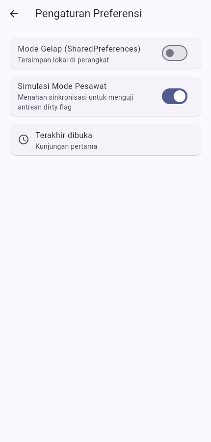

# Minggu 5 — Local Storage & Offline First

Joni Yoga Kusuma · NIM 254107023003 · TI-3F

[Codelab Minggu 5](https://jti-polinema.github.io/flutter-codelab/05-minggu-5-local-storage-offline-first/index.html)

Tanggal metadata commit untuk jadwal tugas: **Kamis, 1 Oktober 2026**. Tanggal ini bukan waktu push GitHub. Verifikasi dan screenshot dilakukan **14 Oktober 2026**.

## Tujuan dan fitur

Menyimpan preferensi melalui SharedPreferences dan catatan terstruktur melalui SQLite di belakang repository.

- Tambah, baca, edit melalui detail, dan hapus catatan; daftar diurutkan menurut pembaruan terbaru.
- Catatan baru/hasil edit memiliki dirty flag. Simulasi sinkronisasi hanya membersihkan versi catatan yang ada pada snapshot awal; edit baru tetap dirty.
- Tema gelap/terang dan waktu kunjungan pengaturan terakhir tersimpan lokal.
- Halaman `/cache` membaca post dari SQLite terlebih dahulu, lalu memperbarui hingga lima post JSONPlaceholder ketika online.
- Mode offline simulasi menahan sinkronisasi dan refresh jaringan tanpa menghalangi CRUD lokal.

## Menjalankan

Flutter 3.47.2 / Dart 3.13.2, `shared_preferences`, `sqflite`, `sqflite_common_ffi_web`, `dio`, `flutter_riverpod`, `go_router`.

```powershell
cd 05-week-5-local-storage-offline-first
flutter pub get
flutter analyze
flutter test
flutter run -d chrome --web-port 8505
```

Untuk Android gunakan `flutter run -d <device-id>`. Web memakai SQLite/WASM dengan persistensi IndexedDB; worker dan WASM disertakan di `web/`. Bila versi paket SQLite berubah, jalankan `dart run sqflite_common_ffi_web:setup --force`. Gunakan host/port browser tetap agar data lokal tetap berada pada origin yang sama. Panduan paket: [sqflite_common_ffi_web](https://pub.dev/packages/sqflite_common_ffi_web).

## Hasil dan screenshot

Pada 14 Oktober 2026, analisis statis bersih, **7 tes lulus**, dan build web berhasil. Tes menguji model, provider, simulasi online/offline, dan edit selama sync menggunakan repository palsu. Lihat [output verifikasi](docs/validation.txt) serta [perbandingan storage dan audit](docs/ai-challenge.md).




Screenshot adalah aplikasi web yang dijalankan. Mode offline pada gambar merupakan simulasi di aplikasi, bukan bukti mode pesawat sistem operasi. Verifikasi Android fisik belum dilakukan.

## Batas sinkronisasi dan refleksi

`syncNotes` mensimulasikan pengakuan server; belum ada upload catatan atau backend. Last-Write-Wins adalah rancangan kebijakan untuk integrasi remote lanjutan, belum protokol konflik dua perangkat yang berjalan. Penghapusan saat ini lokal; sinkronisasi delete memerlukan tombstone/outbox. Cache post pertama harus diisi saat online.

SharedPreferences sesuai untuk nilai kecil; SQLite menyediakan query, pengurutan, indeks, dan update per baris. Dirty flag cukup untuk demonstrasi upsert, sedangkan antrean operasi berurutan memerlukan outbox. Timestamp snapshot mencegah edit yang belum dikirim ikut ditandai selesai ketika sync berlangsung.
