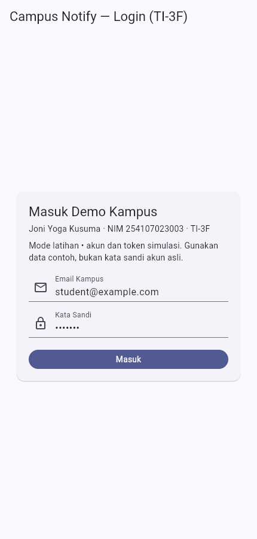
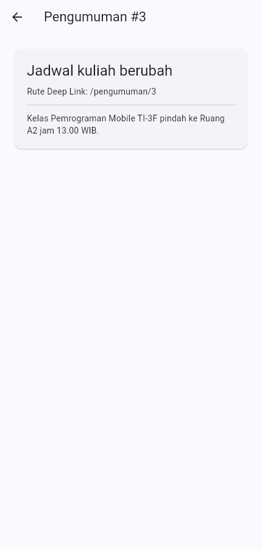

# Minggu 6 — Authentication, Security & FCM

Joni Yoga Kusuma · NIM 254107023003 · TI-3F

Sumber tugas: [Codelab Minggu 6](https://jti-polinema.github.io/flutter-codelab/06-minggu-6-authentication-security-fcm/index.html).
Tanggal penugasan/metadata commit: **Kamis, 8 Oktober 2026**. Validasi dan pengambilan screenshot dilakukan **14 Oktober 2026**; tanggal commit bukan tanggal unggah GitHub.

## Tujuan dan status

Campus Notify memperagakan login mock, penyimpanan token, pembaruan sesi, dan navigasi pengumuman. **Mode demo digunakan; Firebase belum dikonfigurasi dan pengujian FCM pada perangkat belum dilakukan.** Screenshot memperlihatkan aplikasi yang berjalan di browser, bukan bukti pengiriman push.

## Fitur yang berjalan

- Login mock menerima email dengan `@` dan kata sandi minimal enam karakter. Akun contoh: `student@example.com` / `demo123`; bukan akun kampus nyata.
- `TokenStore` menyimpan token simulasi melalui `flutter_secure_storage`; tampilan token dipotong, token singkat disembunyikan seluruhnya. Gunakan HTTPS atau localhost untuk web.
- Route guard mempertahankan tujuan `/pengumuman/:id` ketika perlu login. Payload hanya boleh membuka rute pengumuman numerik.
- Tombol **Simulasi 401 Refresh** menjalankan interceptor Dio dengan transport lokal: 401 → refresh sekali → retry 200. Refresh gagal, token refresh hilang, atau 401 kedua membersihkan sesi dan memicu logout.
- Sakelar topik adalah **simulasi status lokal**. Kartu pengumuman membuka rute dari contoh payload.
- `lib/messaging/push_service.dart` berisi scaffold handler permission, token lifecycle, foreground/background/terminated dan topik. Scaffold belum dipanggil oleh aplikasi demo.

## Matriks pengujian FCM

| State | Perilaku yang perlu dibuktikan | Status aktual |
| --- | --- | --- |
| Foreground | Push masuk, banner lokal tampil, klik membuka `/pengumuman/3` | **Belum diuji**; Firebase/perangkat belum tersedia |
| Background | Banner sistem tampil, klik diproses `onMessageOpenedApp` | **Belum diuji** |
| Terminated | Aplikasi dibuka lewat `getInitialMessage` ke pengumuman | **Belum diuji** |
| Token refresh | Token berubah dan registrasi backend diperbarui | **Belum diuji** |

Integrasi berikutnya memerlukan project Firebase milik pengguna, konfigurasi Android/iOS, inisialisasi Firebase sebelum aplikasi, pemasangan callback ke router, izin notifikasi, serta perangkat uji. Endpoint registrasi yang direncanakan: `POST /devices` melalui HTTPS, body `{"fcm_token":"<token perangkat>","platform":"android"}`, dengan autentikasi backend yang sebenarnya. `initFcmToken(onToken: ...)` harus memanggil endpoint itu untuk token awal dan setiap rotasi. Endpoint produksi belum tersedia; kode demo tidak mengirim token ke server contoh.

## Menjalankan

```powershell
cd 06-week-6-authentication-security-fcm
flutter pub get
flutter run -d chrome
```

Stack: Flutter/Dart, Riverpod, GoRouter, Dio, FlutterSecureStorage. Dependensi Firebase dan local notifications tersedia untuk scaffold integrasi.

## Bukti aplikasi

Login demo dengan penjelasan batasan:



Sesi dan daftar pengumuman; status Firebase tampil jelas:


Tujuan rute pengumuman dari payload simulasi:



## Verifikasi

- `flutter analyze`: tidak ada issue.
- `flutter test`: **11 test lulus**, termasuk retry 401, batas satu retry, refresh gagal, token hilang, dan kegagalan server setelah retry.
- `flutter build web --no-web-resources-cdn`: hasil perintah tersimpan di [build-web.txt](docs/build-web.txt).
- Output analyzer dan test: [validation.txt](docs/validation.txt).
- Catatan bantuan AI, perubahan, dan batasan: [ai-challenge.md](docs/ai-challenge.md).

## Refleksi

Refresh token berumur panjang perlu perlindungan penyimpanan platform; jangan menyimpannya sebagai preferensi biasa atau menampilkannya utuh. Rotasi token FCM perlu dikirim ke backend agar pesan tidak ditujukan ke token lama. Topik cocok untuk pengumuman publik, sedangkan pesan personal membutuhkan tujuan perangkat dengan otorisasi. Pengujian fungsi parsing dan interceptor belum membuktikan perilaku push pada perangkat; matriks FCM tetap terbuka.
