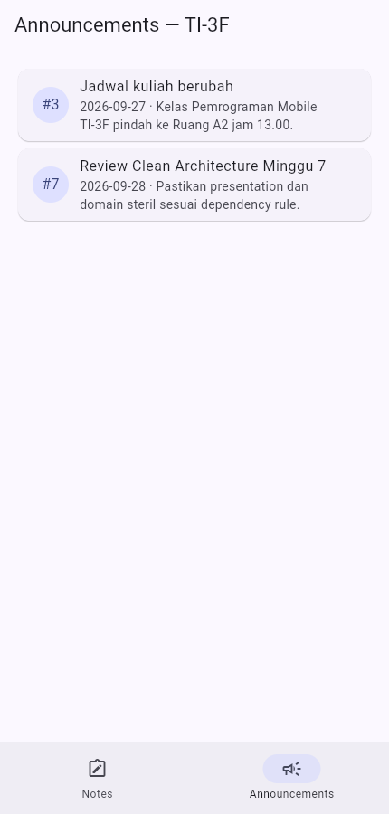

# Minggu 7 — Clean Architecture

Joni Yoga Kusuma · NIM 254107023003 · TI-3F

Sumber tugas: [Codelab Minggu 7](https://jti-polinema.github.io/flutter-codelab/07-minggu-7-clean-architecture/index.html).
Tanggal penugasan/metadata commit: **Kamis, 15 Oktober 2026**. Validasi dan pengambilan screenshot dilakukan **14 Oktober 2026**; metadata commit bukan tanggal unggah GitHub.

## Tujuan dan ruang lingkup

Memisahkan fitur catatan dan contoh pengumuman ke layer presentation, domain, dan data. Aplikasi memiliki daftar catatan, penambahan catatan dengan validasi judul, penyimpanan lokal, serta navigasi pengumuman. Implementasi ini berfokus pada refactor catatan; autentikasi, push FCM, dan sinkronisasi server tidak diimplementasikan dalam aplikasi Minggu 7.

## Struktur dan arah dependensi

```text
presentation → domain ← data
                   ↑
         dependencies.dart (wiring Riverpod)

lib/
├── core/                    # Failure dan fungsi format murni
├── dependencies.dart        # Memilih implementasi repository
├── features/
│   ├── notes/
│   │   ├── domain/          # Entity, interface, GetNotes, AddNote
│   │   ├── data/            # Model, SQLite, adapter browser
│   │   └── presentation/    # Widget dan state Riverpod
│   └── announcements/
│       ├── domain/          # Entity, interface, GetAnnouncements
│       ├── data/            # Repository data contoh
│       └── presentation/    # Widget dan state Riverpod
├── routes.dart
└── main.dart
```

`NoteRepository` adalah kontrak domain. `NoteRepositoryImpl` menggunakan SQLite pada Android/iOS; `BrowserNoteRepository` menyimpan JSON lewat SharedPreferences pada browser agar demonstrasi web dapat digunakan. Pemilihan implementasi berada di `dependencies.dart`. Entity tidak memiliki import Flutter atau database. Data pengumuman berasal dari fixture lokal yang jelas, bukan API langsung. Ikon belum tersinkron menandai catatan lokal; tidak ada klaim upload server.

## Pemetaan refactor

| Bagian awal | Hasil pemisahan |
| --- | --- |
| Model catatan sekaligus mapping storage | Entity `Note` dan model `NoteModel` terpisah |
| Repository sekaligus kontrak storage | Interface domain dan implementasi data |
| Formatting tanggal di halaman | Fungsi `core/format.dart` |
| Instansiasi repository dalam provider presentation | Composition root `dependencies.dart` |
| Validasi input tersebar | Use case `AddNote` menolak judul kosong |

## Menjalankan

```powershell
cd 07-week-7-clean-architecture
flutter pub get
flutter run -d chrome
```

Klik **+**, isi judul dan isi catatan, lalu **Simpan**. Catatan browser tetap ada setelah muat ulang pada origin yang sama. Tombol navigasi **Announcements** membuka dua pengumuman contoh. Android/iOS memakai adapter SQLite; build dan pengujian perangkat native belum dilakukan pada sesi ini. Dukungan database Windows/Linux belum disiapkan.

## Screenshot hasil

Catatan yang ditambahkan lewat aplikasi browser:


Pengumuman dari repository fixture lokal:



## Verifikasi 14 Oktober 2026

- `flutter analyze`: tidak ada issue.
- `flutter test`: **7 test lulus**. Lima test memeriksa domain/format; dua test tambahan memeriksa persistensi adapter browser dan perlindungan data rusak.
- Pemeriksaan presentation untuk API/database/JSON langsung dan import `/data/`: **0 temuan**.
- Pemeriksaan domain/core untuk import framework atau plugin: **0 temuan**.
- `flutter build web --no-web-resources-cdn`: berhasil.
- Output aktual: [validation.txt](docs/validation.txt) dan [build-web.txt](docs/build-web.txt).
- Catatan bantuan AI dan keputusan implementasi: [ai-challenge.md](docs/ai-challenge.md).

## Refleksi

Interface pada domain memungkinkan penggantian SQLite dengan penyimpanan browser tanpa mengubah use case. `AddNote` berguna karena memuat aturan validasi, sementara wrapper pembacaan sederhana tetap menambah navigasi file. Riverpod sudah menyediakan injeksi dependensi sehingga paket DI tambahan belum diperlukan. Pemisahan folder saja tidak membuktikan arsitektur: arah import dan pengujian domain juga perlu diperiksa. Penilaian pribadi mahasiswa atas keputusan ini masih dapat ditambahkan setelah membaca dan menjalankan kode.
