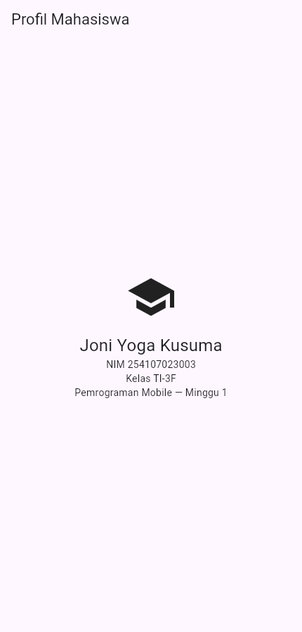
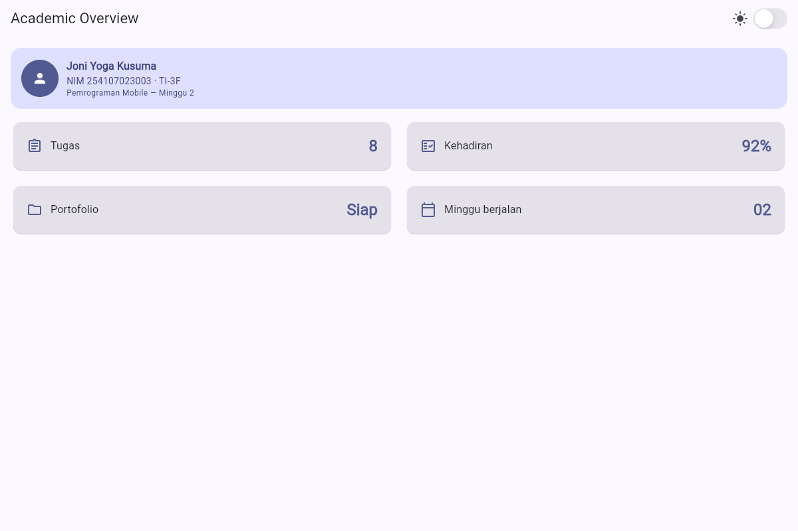
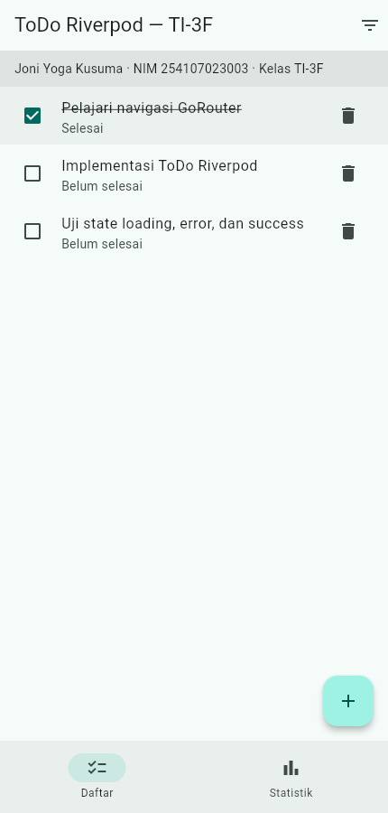
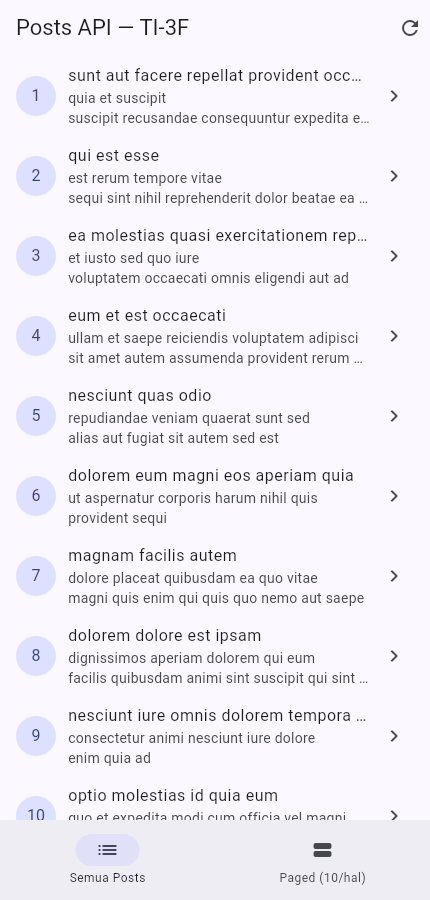
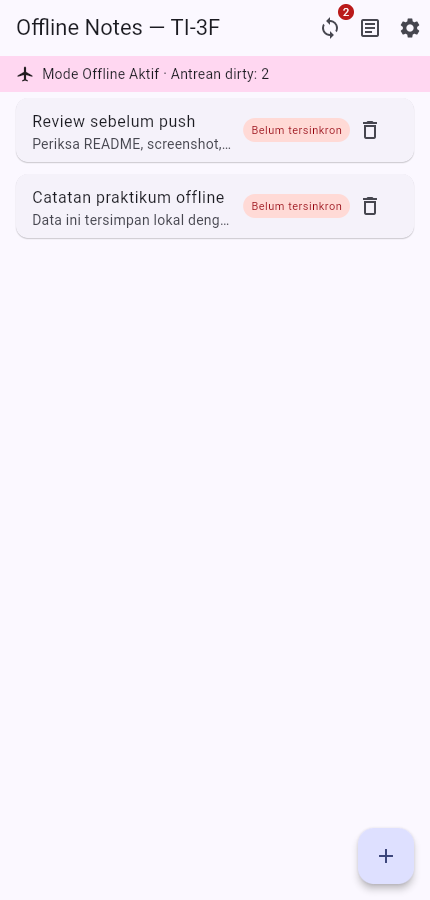
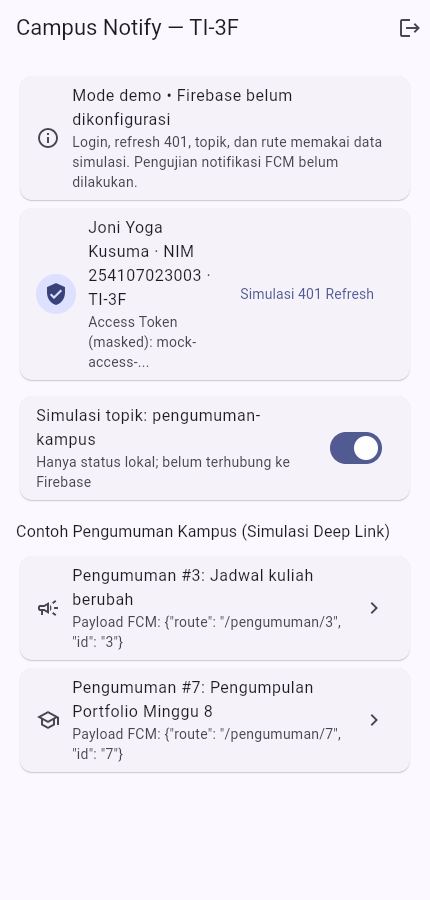
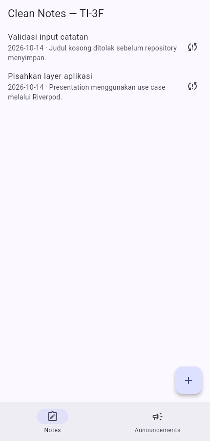
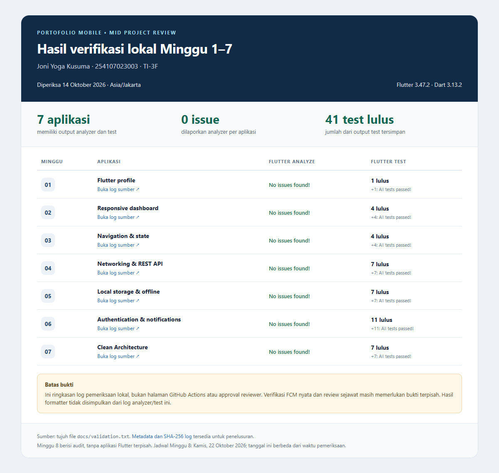

# 254107023003-mobile-course

Portfolio mata kuliah **Pemrograman Mobile**, mengikuti [Flutter Codelab JTI Polinema](https://jti-polinema.github.io/flutter-codelab/).

**Joni Yoga Kusuma** · NIM **254107023003** · **TI-3F** · D4 Teknik Informatika, JTI Polinema.

## Week 1–8

Setiap folder berisi README tugas, source atau dokumen review, serta screenshot hasil. Gambar aplikasi diambil dari build Flutter yang berjalan di browser; bukti ini bukan pengujian pada perangkat Android. Verifikasi ulang dan pengambilan screenshot dilakukan **14 Oktober 2026**.

Tanggal berikut adalah **tanggal commit portofolio** yang diatur per Kamis sesuai jadwal. Metadata commit tidak menunjukkan waktu upload/push sebenarnya di GitHub. Riwayat lama repository tetap dipertahankan.

1. **[Week 1 — Mobile Development Ecosystem & Flutter Refresh](01-week-1-mobile-development-ecosystem-flutter-refresh/)** — Kamis, **3 September 2026**. Profil mahasiswa, setup Flutter, dan widget dasar.
2. **[Week 2 — Declarative UI & Responsive Design](02-week-2-declarative-ui-responsive-design/)** — Kamis, **10 September 2026**. Academic Overview, satu/dua kolom, tema terang/gelap, aksesibilitas.
3. **[Week 3 — Navigation & State Management](03-week-3-navigation-state-management/)** — Kamis, **17 September 2026**. ToDo, navigasi detail, filter, Riverpod, statistik asinkron.
4. **[Week 4 — Networking & REST API](04-week-4-networking-rest-api/)** — Kamis, **24 September 2026**. Dio, JSON model, repository, detail post, pagination, error/retry.
5. **[Week 5 — Local Storage & Offline First](05-week-5-local-storage-offline-first/)** — Kamis, **1 Oktober 2026**. CRUD catatan lokal, preferensi tema, cache bacaan, dan antrean dirty. Sinkronisasi server masih simulasi.
6. **[Week 6 — Authentication, Security & FCM](06-week-6-authentication-security-fcm/)** — Kamis, **8 Oktober 2026**. Login, refresh sesi, route guard, dan deep link dalam **mode demo**. Firebase belum dikonfigurasi; pengiriman FCM pada perangkat belum diuji.
7. **[Week 7 — Clean Architecture](07-week-7-clean-architecture/)** — Kamis, **15 Oktober 2026**. Pemisahan data/domain/presentation, repository, use case, dependency injection, dan unit test.
8. **[Week 8 — Mid Project Review & Code Review](08-week-8-mid-project-review/)** — Kamis, **22 Oktober 2026**. Audit kode, log verifikasi, checklist review, template PR, dan workflow CI. Review serta persetujuan dari rekan manusia belum tersedia.

Week 7 dan Week 8 menggunakan metadata tanggal setelah tanggal verifikasi. Folder Week 9–16 merupakan tempat tugas berikutnya dan belum dikerjakan.

## Screenshot hasil

### Week 1 — Profil mahasiswa



### Week 2 — Dashboard responsif



### Week 3 — ToDo dan state management



### Week 4 — Data REST API



### Week 5 — Catatan lokal saat offline



### Week 6 — Autentikasi demo



### Week 7 — Clean Notes



### Week 8 — Hasil pemeriksaan



## Menjalankan tugas

Gunakan **Flutter 3.47.2 stable / Dart 3.13.2**, sesuai environment dan lockfile yang diverifikasi. Buka salah satu folder Week 1–7, kemudian:

```sh
flutter pub get
flutter analyze
flutter test
flutter run -d chrome
```

Untuk emulator/perangkat Android, gunakan `flutter run` setelah perangkat terdeteksi. Detail dependensi dan batasan platform dijelaskan di README masing-masing minggu. Week 8 berisi dokumen evaluasi dan tidak memiliki aplikasi Flutter terpisah.

Log pemeriksaan tersimpan di `docs/validation.txt` pada tiap folder aplikasi. Workflow [Flutter CI](.github/workflows/ci.yml) memeriksa ketujuh project; status CI remote harus dilihat pada [GitHub Actions](https://github.com/jonitodev/254107023003-mobile-course/actions).

## Dokumentasi pembelajaran

- [Ringkasan portfolio](portfolio-summary.md)
- [Learning journal](notes/learning-journal/)
- [Refleksi](notes/reflections/)
- [Referensi per minggu](notes/resources/)
- [Checklist review Week 8](08-week-8-mid-project-review/docs/review-checklist.md)

Penyempurnaan source, dokumentasi, dan verifikasi dalam pembaruan ini dibantu AI. Latihan mandiri, pemahaman materi, pengujian Firebase pada perangkat, dan peer review perlu dibuktikan sendiri sesuai ketentuan codelab. Dokumentasi tidak mengklaim tahapan tersebut sudah dilakukan jika tidak ada bukti.
